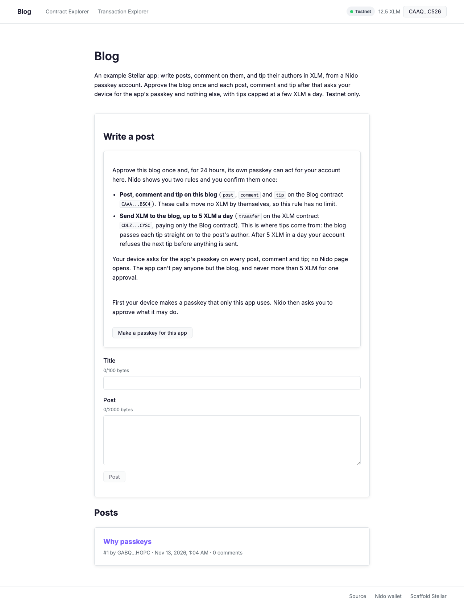
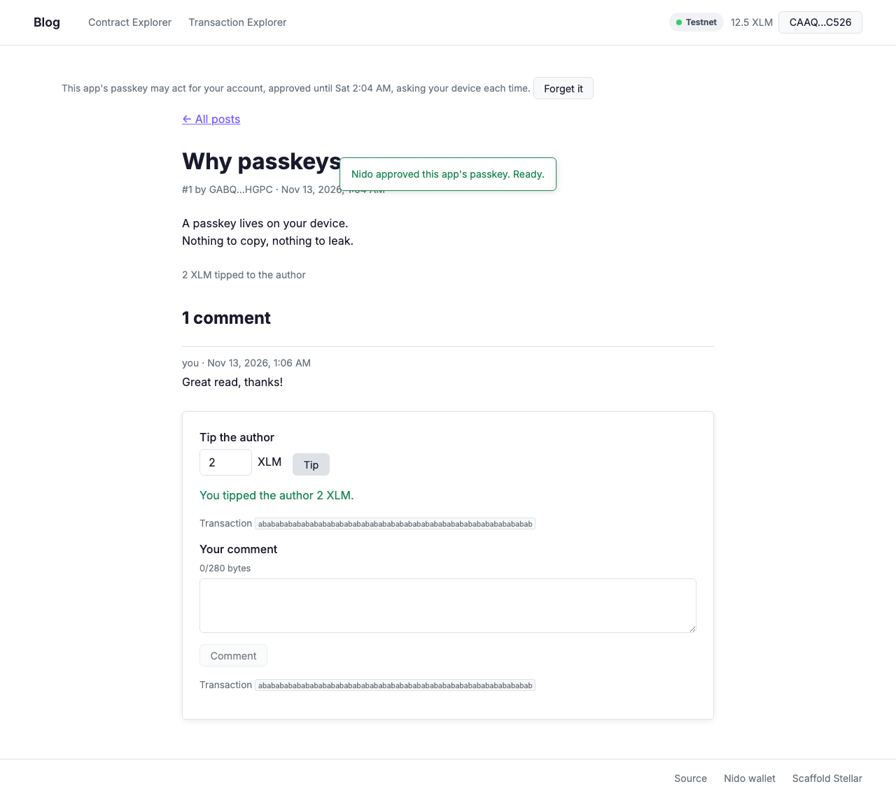

# Blog: a Nido example with comments and tips

**Live: <https://nidohq.github.io/blog/>** (Stellar testnet). Until the blog is
deployed to testnet it is a read-only demo with seeded posts; see
[Deploying to GitHub Pages](#deploying-to-github-pages).

An example Stellar app made from
[nidohq/scaffold-template](https://github.com/nidohq/scaffold-template): write
posts, comment on them, and tip their authors in XLM. People sign in with a
passkey: a [Nido](https://test.nido.fyi) smart account sits in the wallet
picker. The app makes a second passkey of its own, and the owner approves it
once, in one Nido popup, under two Perch rules. After that each post, comment
and tip asks the device for the app's passkey and nothing else: no Nido page, no
wallet prompt. Tips stop at 5 XLM a day. Testnet only.



## What the approval allows

The app asks for one grant per contract a call authorizes (`grants` in
[`app/src/blog.ts`](app/src/blog.ts)), and shows them in plain words before the
owner approves ([`BlogAccess.tsx`](app/src/components/BlogAccess.tsx)):

| Rule        | In plain words                          | Contract | Functions                                 | Limit                                    |
| ----------- | --------------------------------------- | -------- | ----------------------------------------- | ---------------------------------------- |
| `blog`      | Post, comment and tip on this blog      | Blog     | `post`, `comment`, `tip`                  | None: these calls move no XLM themselves |
| `blog-tips` | Send XLM to the blog, up to 5 XLM a day | XLM      | `transfer`, paying only the Blog contract | 5 XLM a day                              |

Both last 24 hours, so 5 XLM is also the most one approval can ever spend. Once
5 XLM has gone out in a day, the next tip stops before the device is asked, the
app says until when, and its Tip button stays off; posting and commenting carry
on.

**Why 5 XLM a day.** A new Nido account arrives with 5 test XLM, so the cap lets
someone tip with all of it and no more, a few XLM at a time. Change
`DAILY_TIP_CAP` in `app/src/blog.ts` for another; Nido shows the owner the
number before they approve.

**Why tips go through the blog.** A rule's `to` can name one address. If `tip`
paid the author directly, the XLM rule would need no `to`, and the app's passkey
could then call XLM `transfer` on its own and pay anyone, up to the cap, because
Perch checks rules per call, not per call tree. So `tip` takes the XLM from the
tipper to the blog and has the blog pay the author in the same call. The
tipper's authorization names only the blog as a recipient, and the blog keeps
nothing.

## The contract

[`contracts/blog`](contracts/blog/src/lib.rs):

| Function                          | Does                                                                                 |
| --------------------------------- | ------------------------------------------------------------------------------------ |
| `post(author, title, body)`       | Writes a post with the ledger's time; returns its number (from 1)                    |
| `comment(author, post_id, text)`  | Comments on a post; returns the comment's index on it (from 0)                       |
| `tip(tipper, post_id, amount)`    | Moves `amount` stroops of XLM from the tipper to the post's author, through the blog |
| `post_count()`                    | How many posts there are                                                             |
| `get_post(id)`                    | A post, with its comment count and XLM tipped so far                                 |
| `posts(first, limit)`             | Up to 20 posts from number `first` on                                                |
| `comments(post_id, first, limit)` | Up to 20 comments on a post from index `first` on                                    |

Storage stays bounded: titles are at most 100 bytes, bodies 2000 and comments
280 (UTF-8 bytes, which the forms count as you type), every read returns at most
20 items, and each post, each comment and each post's counters is its own entry,
so a comment or a tip never rewrites a post's text. It refuses empty text, text
over a cap, a post that doesn't exist, a tip of zero or less, and a tip on your
own post, each with its own error code. `cargo test -p blog` runs its 19 unit
tests, which include `env.auths()` checks: posting and commenting authorize the
blog alone, and a tip authorizes the blog and, under it, an XLM `transfer` to
the blog.

## Run it

You need Node 22.12+, Rust with the `wasm32v1-none` target and the
[Stellar CLI](https://developers.stellar.org/docs/tools/cli/install-cli).

**Offline, no keys, no deploy:** prototype clients with a placeholder contract
ID, and the tests.

```sh
npm ci
cargo test -p blog          # the contract's unit tests
npm run prepare:prototype   # clients from the compiled contract, placeholder ID
npm run test:e2e            # the browser tests below
```

**Against your own testnet deployment:** `deploy:testnet` deploys the blog with
a throwaway deployer that Friendbot funds, pins its ID under `testnet:` in
[`scaffold.yml`](scaffold.yml) and writes its client.

```sh
cp .env.example .env
npm run tools:scaffold && npm ci && npm run doctor
npm run deploy:testnet      # deploys contracts/blog, pins its ID, writes its client
npm run dev                 # http://localhost:5421
```

Open it at `localhost`, not `127.0.0.1`: browsers refuse passkeys on an IP
address. Press Connect and choose Nido. Without a Nido account yet, the popup
sends you to create one: one passkey, and it arrives with 5 test XLM. Then make
the app's passkey, approve the blog in Nido's popup (one confirmation), and
post. To tip, open a post by someone else.

## Tests

`npm run test:e2e` runs [`e2e/tests/blog.spec.ts`](e2e/tests/blog.spec.ts) with
the template's Playwright setup: the real app, wallet picker, Nido popup
transport, a virtual authenticator's passkey and its WebAuthn signature, and the
generated client, with Nido's pages, its relayer and the RPC mocked
([`mocks.ts`](e2e/tests/mocks.ts)). The blog's storage lives in
[`blog-chain.ts`](e2e/tests/blog-chain.ts), so posts, comments and tips the
relayer takes show up in later reads. It checks that:

- anyone reads posts (newest first) and a post's comments without connecting;
- one approval asks for exactly the two rules above, and after it a post, a
  comment and a tip each take one device prompt and no Nido page, signed under
  the blog rule (and, for the tip, the XLM rule);
- tips of 2 and 3 XLM go through, the next stops before the device is asked,
  "Tip cap reached until ≈ …" survives a reload, and commenting still works;
- the forms count bytes the way the contract does.

These prove the app's side of each exchange, not that the chain accepts it. The
contract itself was also run on a local quickstart network: post, comment, a 2
XLM tip that raised the author's balance by exactly 2 XLM and left the blog
none, and the refusals for a tip on your own post, a 281-byte comment and a
missing post. The [Blog tests](.github/workflows/blog-tests.yml) workflow runs
the unit and browser tests on every pull request.



## Deploying to GitHub Pages

GitHub Pages serves the `gh-pages` branch (repo setting: Pages source "Deploy
from a branch", branch `gh-pages`, folder `/ (root)`). Two workflows write to
it, and both build with [`scripts/build-site.sh`](scripts/build-site.sh):

- [`pages.yml`](.github/workflows/pages.yml), on every push to `main`: the quick
  start above on a fresh runner, lint, format check and unit tests, then the
  site at the branch root, <https://nidohq.github.io/blog/>.
  `clean-exclude: pr-preview` keeps the previews.
- [`pr-preview.yml`](.github/workflows/pr-preview.yml), on every pull request
  from this repository (forks can't push to `gh-pages`): the site under
  `pr-preview/pr-<number>/`, with a sticky comment linking it, removed when the
  pull request closes.

`BASE_PATH` (`/blog/` or `/blog/pr-preview/pr-<n>/`) sets Vite's `base` and the
router's, and the build copies `index.html` to `404.html` so a refresh on
`/posts/3` still loads the main site. Pages serves only the root's `404.html`,
so in a preview, open posts from its own links rather than refreshing them.

**Demo until the blog is on testnet.** The site needs a contract to call, and
nothing in this repository has deployed one yet. Until `scaffold.yml` pins a
`testnet:` ID for the blog, `build-site.sh` builds a read-only demo: prototype
clients with a placeholder ID and `PUBLIC_BLOG_DEMO=true`, so the app reads
seeded posts and comments from the same in-memory blog the browser tests use
([`app/src/demo`](app/src/demo)), says "Demo data: the contract is not deployed
yet" on every page, and keeps its post, comment and tip forms closed. With a
pin, it builds against the real contract, the demo code is not in the bundle,
and the script fails the build if it finds it there. To leave the demo:

1. From a checkout of `main`, run `npm run tools:scaffold && npm ci`, then
   `npm run deploy:testnet`. It deploys `contracts/blog` to testnet with a
   throwaway Friendbot-funded key and pins the new ID under `testnet:` in
   `scaffold.yml`.
2. Commit `scaffold.yml` (and `package-lock.json` if it changed) and merge it to
   `main`. The Pages workflow builds against that ID and deploys.

A testnet reset removes the deployment; repeat both steps. A new deployment has
a new ID, so sessions approved for the old one no longer cover it and the app
asks again.

Every `nidohq.github.io/<repo>/` site shares the origin
`https://nidohq.github.io`, so this blog and Guess the Number keep their
sessions in the same `localStorage` and make their passkeys for the same host.
They don't clash: each asks for rules under its own labels (`blog`, `blog-tips`;
`guess`, `guess-xlm`), and Nido replaces a rule only when the label matches.
Nido's approval page names the origin, not the path. A custom domain gives the
app an origin of its own.

## How it was made

```sh
stellar scaffold init --template nidohq/scaffold-template blog --yes
```

That is template `main` at
[`6f41265`](https://github.com/nidohq/scaffold-template/commit/6f41265a4225703c057d6d04e07c3594a1a3972f),
with stellar-scaffold 0.0.31, as Guess the Number was made. In this repository's
history, "Add app generated by stellar scaffold init" is that output unchanged,
and the commit after it makes it the blog:

- `contracts/blog` in place of `contracts/guess-the-number`, in `scaffold.yml`
  (`local` and `testnet-dev`) and the contract release workflow;
- the app: `src/blog.ts` (grants, caps, errors), the post list and post pages,
  the write, comment and tip forms, and the plain-words approval card;
- the browser tests: `blog.spec.ts` and `blog-chain.ts` in place of
  `guess.spec.ts`, and `mocks.ts` taught to answer the blog's reads, carry out
  relayed calls, and count only tips against the cap;
- the package name (`blog-example`), page title, this README, and the dev port
  `PORT=5421`, the port `npm run new-app` gives an app named blog;
- GitHub Pages from the `gh-pages` branch with per-PR previews, as
  stellar-registry/perch does it, the demo build above, and the Blog tests
  workflow;
- the template-only files an app made with `npm run new-app` doesn't carry:
  `CHANGELOG.md`, `CONTRIBUTING.md`, `scripts/new-app.*` and `scripts/blank/`.

The other sample contracts (`fungible-allowlist`, `nft-enumerable`) stay as the
template has them.

## Building on it

- [`NIDO.md`](NIDO.md): the template's guide. Your own contract in five steps,
  the call pattern, the rules a Nido account follows, and what to do when Nido's
  relayer says no.
- [`AGENTS.md`](AGENTS.md): the same rules for coding agents.

Nido is at <https://github.com/nidohq/nido>; the Perch policy language its
accounts enforce is at <https://github.com/stellar-registry/perch>.

The one secret key in the tree, in
[`.github/workflows/build.yml`](.github/workflows/build.yml), comes unchanged
from the public upstream
[stellar-scaffold/ui](https://github.com/stellar-scaffold/ui) workflow: it funds
a throwaway identity on the CI job's local quickstart network.

[License](LICENSE) · [Security](SECURITY.md) ·
[Code of conduct](CODE_OF_CONDUCT.md)
